# 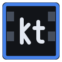 kinetren

**A free, source-available video editor for Linux.**
[kinetren.com](https://kinetren.com) · [Discord](https://discord.gg/w8enAWJSc) · [Download](https://github.com/kinetren/kinetren/releases)

[](LICENSE)


[](https://github.com/kinetren/kinetren/releases)
[](https://github.com/kinetren/kinetren/commits)
[](https://github.com/kinetren/kinetren/stargazers)
[](https://discord.gg/w8enAWJSc)

kinetren is free to download, use, study, modify and share. It gives you a multi-track
timeline with real-time preview, nested reels, 33 transitions, 26 video and 18 audio
effects, curve automation on every parameter, Slowed+Reverb for picture and sound,
titles and generators. Export to MP4 renders exactly what the preview shows.

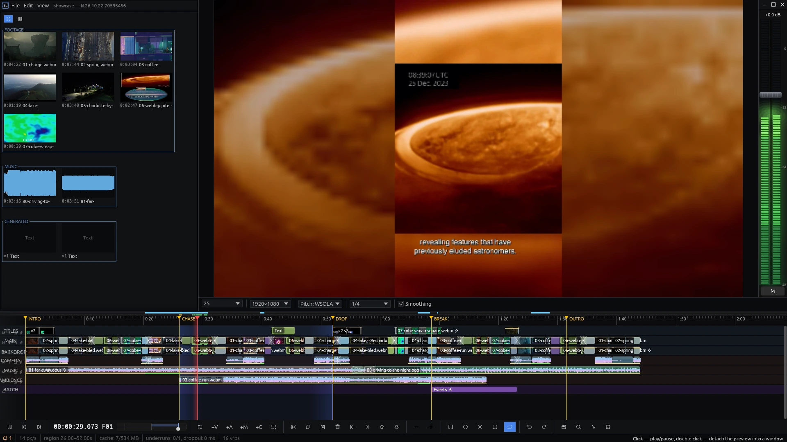

## Features

### Timeline and nested reels

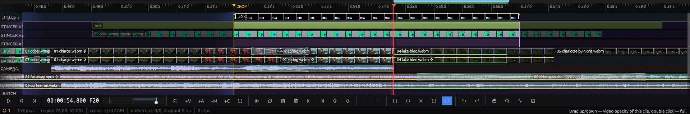

Video, audio and morph tracks, each with mute, solo, lock, its own effects, opacity and
blend mode. Collapse any selection into a **reel** and use it as often as you like: edit
the reel once and every copy follows. **Enter** expands a reel right on the timeline, as
above: its tracks open under the instance, what lies outside the instance is veiled, and
the rest of the edit keeps playing around it. Markers, a region with loop, fades from the
corners of every event, a level line for opacity and volume, and drag one event over
another to get a crossfade.

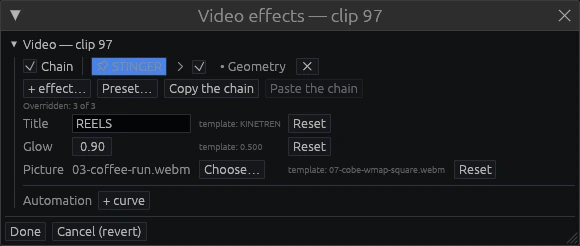

A reel can **publish** its parameters: right-click any parameter inside it. Every copy
then sets its own values. Here the second copy of STINGER has its own title, a stronger
glow and another picture, while the first copy keeps the reel's values.

### Slowed+Reverb with automation curves

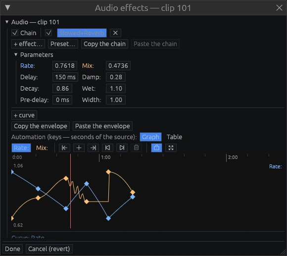

Slow the music down and drown it in reverb, and the picture slows with it. Here the rate
glides from 1.0 to 0.66 and back while the mix follows its own curve. Every parameter of
every effect, transition and title can be animated the same way.

### Video effects

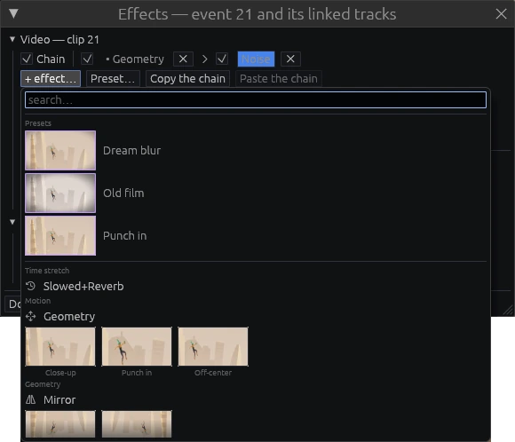

Geometry, Mirror, Corner Pin, Blur, Sharpen, Radial Blur, Greenscreen, Drop Shadow,
Edges, Noise, VHS, Event Grid, Vignette, Pixelate, Halftone, Glow, Pan 3D, Cylinder 3D,
Color Grade, Duotone, Posterize, Chromatic Aberration, Lens Distort, Twirl, Ripple,
Kaleidoscope. The gallery previews each effect on your own footage. Save any chain as a
preset.

Audio: Gain, Slowed+Reverb, Pitch Shift, Filter, EQ, Distortion, Bitcrusher, Tremolo,
AutoPan, Vibrato, Chorus, Flanger, Phaser, Delay, Compressor (with ducking under speech),
Gate, Limiter, Stereo Width.

### Titles and generators

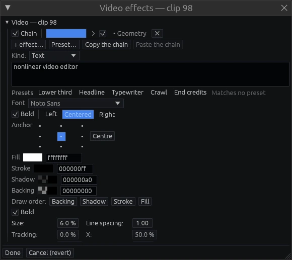

Titles with presets (lower third, headline, typewriter, crawl, end credits), solid
colours, gradients, shapes, a countdown leader and test signals.

### Transitions

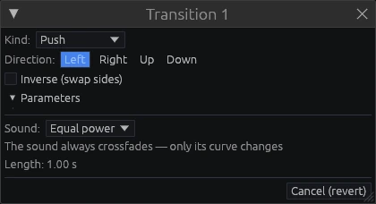

33 transitions: wipes, iris, clock, push, slide, zoom, spin, whip pan, blinds, cube, page
peel, glitch, film burn, light leaks and more.

### Morpher

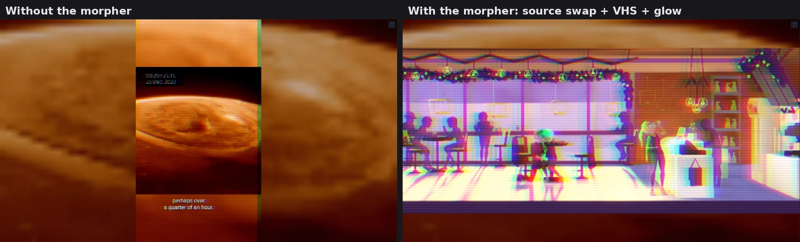

A morpher changes everything under it for as long as it lasts, like an adjustment layer
that can also swap the source. Above, the same frame without and with it: the clips under
the morpher take another source and get a VHS look with glow. Fade it in and out, set its
strength, or bake it into the events.

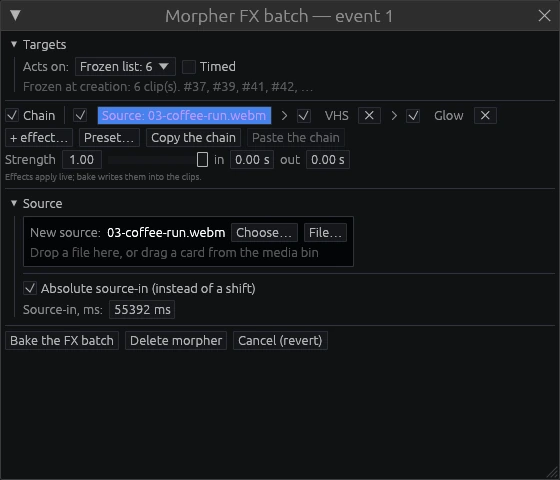

### Media bin

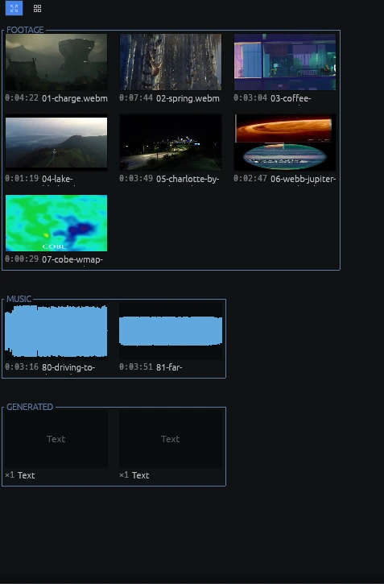

Thumbnails, scrubbing, groups. Missing files open as placeholders and come back by
themselves.

### Export

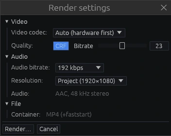

MP4 with your system's encoders (hardware first), CRF or bitrate, up to 4K. Render the
region or the whole project.

### Search

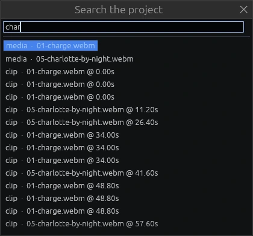

**Ctrl+F** finds media, events, markers, tracks and bin groups by name; Enter jumps to the
result.

### Diagnostics

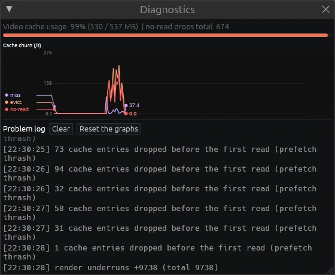

Live numbers on playback, cache and decoding, for when something is slow.

kinetren speaks English, Spanish, Simplified Chinese, Russian and Arabic.

## Install

kinetren runs on Linux x86-64 with glibc 2.35 or newer (Ubuntu 22.04, Debian 12, Fedora
36 and later). It uses the FFmpeg 6, 7 or 8 already installed on your system, ALSA for
sound, and any GPU driver with Vulkan or OpenGL. Without a GPU it falls back to the CPU.

**From a release:** download the archive from
[Releases](https://github.com/kinetren/kinetren/releases), unpack it and run:

```bash
./install.sh
```

kinetren then appears in your applications menu (`kinetren` from a terminal).

**From source:** all you need is Docker, make and git. The build runs in a container
and produces the same archive as a release:

```bash
git clone https://github.com/kinetren/kinetren.git
cd kinetren
make
make install
```

`make run` starts the freshly built editor without installing it, and `make help` lists
the other commands. Building with your own Rust toolchain is described in
[CONTRIBUTING.md](CONTRIBUTING.md#build).

**Windows (x86-64, Windows 10 or 11):** download `kinetren-<version>-windows-x86_64.zip`
from [Releases](https://github.com/kinetren/kinetren/releases), unpack it anywhere and
start `kinetren.exe`; nothing is installed. FFmpeg is not in the zip. On the first start
the program offers **Download** (the FFmpeg 8.1.2 shared build by gyan.dev, GPLv3, about
57 MB, checked against a checksum built into kinetren) or **Locate folder…** for a shared
FFmpeg 6, 7 or 8 you already have, for example
`winget install Gyan.FFmpeg.Shared --version 8.1.2`. *View → FFmpeg…* shows which folder
is used and why others were not. The executables are not code-signed yet, so SmartScreen
may warn: *More info → Run anyway*. `make windows` builds the same zip from source.

## First steps

Drop video files on the window and they land on the timeline. **Space** plays, **S**
splits, double-click an event for its effects, **Ctrl+S** saves, and
**File → Render to MP4…** exports. The
[getting started guide](docs/guide/getting-started.md) walks through a first edit, and
[Keyboard and mouse](docs/guide/shortcuts.md) lists every key.

`kt-cli` renders and exports without a window:

```bash
kt-cli export project.kt out.mp4
```

## Documentation

- [Getting started](docs/guide/getting-started.md)
- [The timeline](docs/guide/timeline.md)
- [Effects and automation](docs/guide/effects-and-automation.md)
- [The morpher](docs/guide/morpher.md)
- [Reels and generators](docs/guide/compositions-and-generators.md)
- [Export and kt-cli](docs/guide/export.md)
- [Keyboard and mouse](docs/guide/shortcuts.md)
- [Contributing](CONTRIBUTING.md)

## Privacy

Release builds send anonymous usage statistics to [PostHog](https://posthog.com) (servers in
the EU), so we can see how many people run kinetren, how long a session lasts and how often it
ends without a clean close. On the first start the program says so in the notices window.

- **Sent:** program start and clean close, session length, version, OS and processor type,
  interface language, and a random install number that is not tied to you or your computer.
- **NOT sent:** projects, file names and paths, media, frames or sound, your name, the
  computer name. The IP address is not stored.
- **Turn it off:** View / Send anonymous usage statistics, or start with
  `KINETREN_TELEMETRY=0` (or `DO_NOT_TRACK=1`). A plain `cargo build` carries no key and
  sends nothing; `make` and the release tarball do.

## Community

Questions, ideas and bug reports: join the [Discord server](https://discord.gg/w8enAWJSc)
or visit [kinetren.com](https://kinetren.com).

## License

kinetren is **free and source-available** under the
[kinetren Non-Commercial License 1.0](LICENSE). You may use, study, modify and share it,
but not sell or monetize the program itself without a license from kinetren. What you
make with it is yours: videos, audio and projects carry no restrictions, paid work
included.
