# 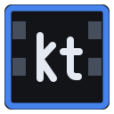 kinetren

**A free, source-available video editor for Linux and Windows.**
[kinetren.com](https://kinetren.com) · [Discord](https://discord.gg/w8enAWJSc) · [Download](https://github.com/kinetren/kinetren/releases)

[](LICENSE)


[](https://github.com/kinetren/kinetren/releases)
[](https://github.com/kinetren/kinetren/commits)
[](https://github.com/kinetren/kinetren/stargazers)
[](https://discord.gg/w8enAWJSc)

kinetren is free to download, use, study, modify and share. It gives you a multi-track
timeline with real-time preview, nested reels, 33 transitions, 29 video and 18 audio
effects, shape masks, curve automation on every parameter, Slowed+Reverb for picture and
sound, titles, and picture and sound generators. Export to MP4 renders exactly what the
preview shows.

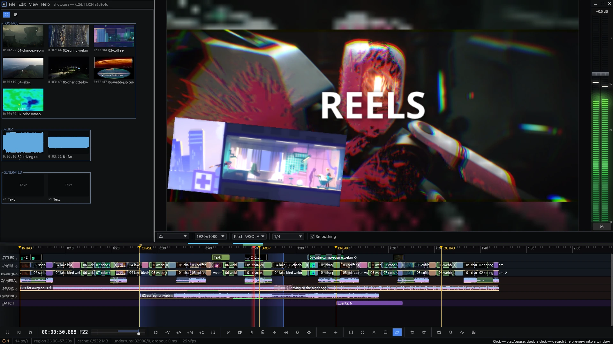

## Features

### Timeline and nested reels

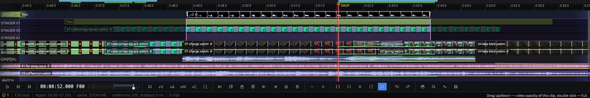

Video, audio, morph and camera tracks, each with mute, solo, lock, its own effects,
opacity and blend mode. Collapse any selection into a **reel** and reuse it: edit it once
and every copy follows. **Enter** expands a reel in place, as above, while the rest of
the edit keeps playing around it. Markers, a looped region, fades from the corners of
every event, a level line for opacity and volume; drop one event over another for a
crossfade.

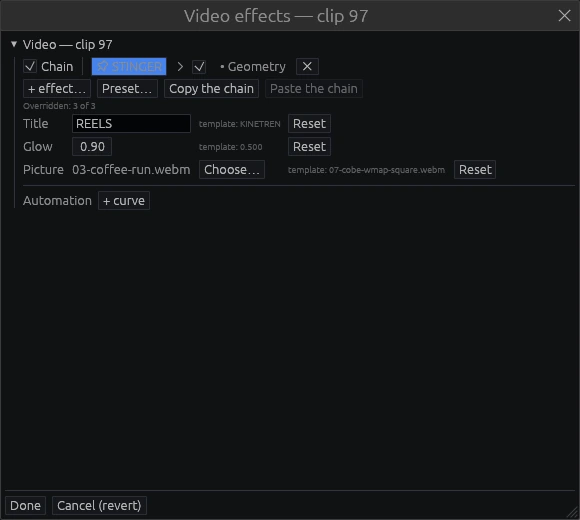

A reel can **publish** its parameters (right-click one inside it), and every copy sets
its own values: here the second copy of STINGER has its own title, glow and picture.

### Slowed+Reverb with automation curves

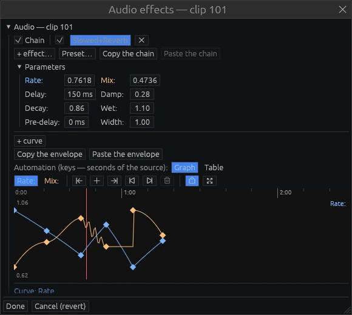

Slow the music down and drown it in reverb, and the picture slows with it. Here the rate
glides from 1.0 to 0.66 and back while the mix follows its own curve. Every parameter of
every effect, transition and title can be animated the same way.

### Video effects

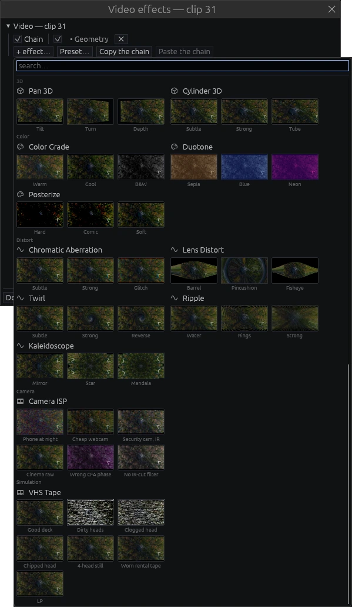

Geometry, Mirror, Corner Pin, Blur, Sharpen, Radial Blur, Greenscreen, Drop Shadow,
Edges, Noise, VHS, EventGrid, Vignette, Pixelate, Halftone, Glow, Pan 3D, Cylinder 3D,
Color Grade, Duotone, Posterize, Chromatic Aberration, Lens Distort, Twirl, Ripple,
Kaleidoscope, plus three simulations below. The gallery previews each effect on your own
footage. Save any chain as a preset.

Audio: Gain, Slowed+Reverb, Pitch Shift, Filter, EQ, Distortion, Bitcrusher, Tremolo,
AutoPan, Vibrato, Chorus, Flanger, Phaser, Delay, Compressor (with ducking under speech),
Gate, Limiter, Stereo Width.

### Masks

Rectangle, ellipse and Bézier pen, drawn right on the preview. Feather, expansion,
opacity, invert, and add / subtract / intersect / difference between masks. A mask cuts
the event's picture, limits one effect (a blur on a face only) or cuts a whole track; its
shape can be keyed over time.

### Simulations

Three effects model the real process instead of painting its look:

- **VHS Tape** records the picture to tape and plays it back: FM luma, colour-under
  chroma, two or four heads on a drum, SP/LP/EP, tracking, a TBC, one deck or two. Click a
  head on the drawn drum to make it dirty, clogged or chipped.
- **Camera ISP** turns the frame back into a scene and films it again: lens, colour
  mosaic (Bayer, Quad Bayer, X-Trans, RGBW, RGB-IR), a sensor with real noise, and every
  block of the camera's processor, each one switchable or set wrong. **View** shows the
  picture after any stage.
- **Datamosh** runs its own video codec over the clip and breaks it on purpose: dropped
  keyframes, blooming motion, borrowed motion vectors, with curves and Reset keys on the
  beat.

### Titles and generators

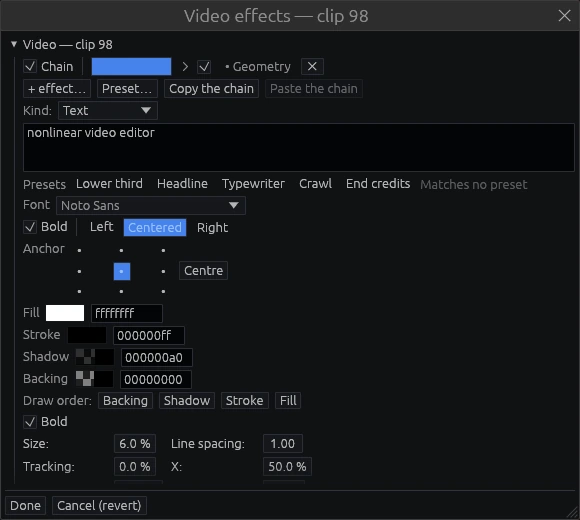

Titles with presets (lower third, headline, typewriter, crawl, end credits), solid
colours, gradients, shapes, a countdown leader and test signals. Sound: line-up tone,
white/pink/brown noise, sine sweep, sync beeps and silence.

### Transitions

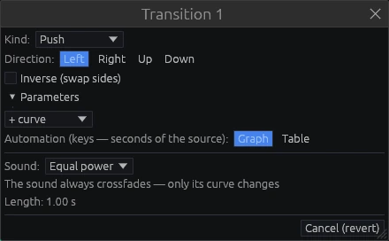

33 transitions: wipes, iris, clock, push, slide, zoom, spin, whip pan, blinds, cube, page
peel, glitch, film burn, light leaks and more.

### Morpher

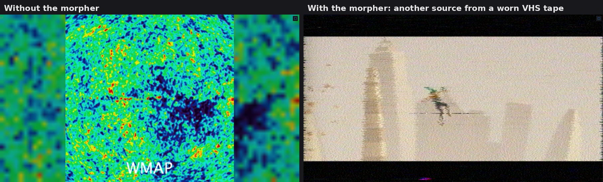

A morpher changes everything under it for as long as it lasts, like an adjustment layer
that can also swap the source. Above, the clips under it take another source and get a VHS
look with glow. Fade it, set its strength, or bake it into the events.

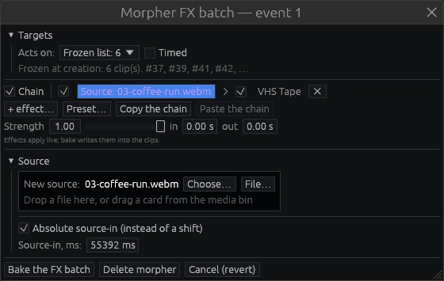

### Media bin

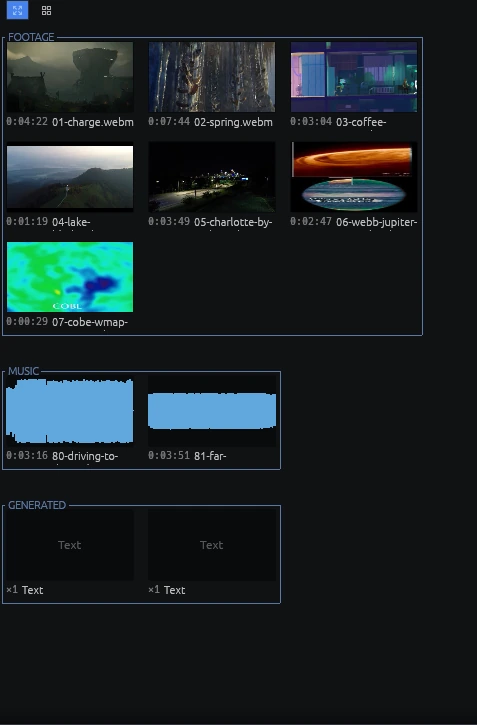

Thumbnails, scrubbing, groups. Missing files open as placeholders and come back by
themselves.

### Export

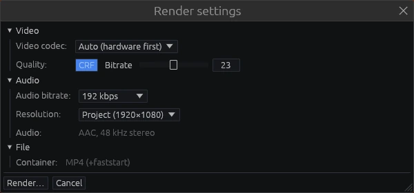

MP4 with your system's encoders (hardware first), CRF or bitrate, up to 4K. Render the
region or the whole project.

### Search

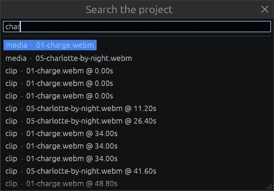

**Ctrl+F** finds media, events, markers, tracks and bin groups by name; Enter jumps to the
result.

### Diagnostics

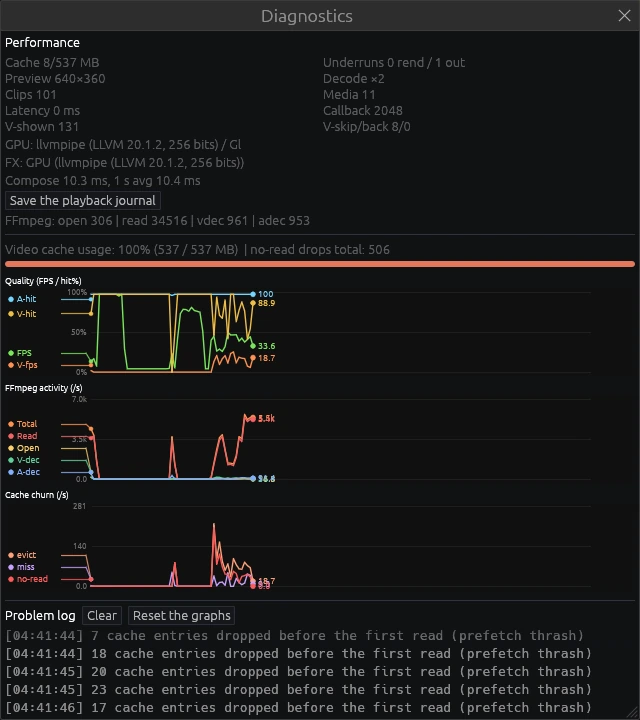

Live numbers and three graphs (playback, FFmpeg activity, cache) for when something is
slow. If the program crashes, a window says so at once with the error and the log, and
**Restore the project** brings your unsaved work back.

kinetren speaks English, Spanish, Simplified Chinese, Russian and Arabic.

## Install

kinetren runs on Linux x86-64 with glibc 2.35 or newer (Ubuntu 22.04, Debian 12, Fedora
36 and later). It uses the FFmpeg 6, 7, 8 or 9 already installed on your system, ALSA for
sound, and any GPU driver with Vulkan or OpenGL. Without a GPU it falls back to the CPU.

**From a release:** download the archive from
[Releases](https://github.com/kinetren/kinetren/releases), unpack it and run:

```bash
./install.sh
```

kinetren then appears in your applications menu (`kinetren` from a terminal).

**From source:** all you need is Docker, make and git. The build runs in a container
and produces the same archive as a release:

```bash
git clone https://github.com/kinetren/kinetren.git
cd kinetren
make
make install
```

`make run` starts the freshly built editor without installing it, and `make help` lists
the other commands. Building with your own Rust toolchain is described in
[CONTRIBUTING.md](CONTRIBUTING.md#build).

**Windows (x86-64, Windows 10 or 11):** download `kinetren-<version>-windows-x86_64.zip`
from [Releases](https://github.com/kinetren/kinetren/releases), unpack it anywhere and
start `kinetren.exe`; nothing is installed. FFmpeg is not in the zip: on the first start
the program offers **Download** (the FFmpeg 9.0.2 shared build by gyan.dev, GPLv3, about
57 MB, checked against a built-in checksum) or **Locate folder…** for a shared FFmpeg 6–9
you already have (`winget install Gyan.FFmpeg.Shared --version 9.0.2`). *File →
Preferences… → FFmpeg…* shows which folder is used and why. The executables are not
code-signed yet, so SmartScreen may warn: *More info → Run anyway*. `make windows` builds
the same zip from source.

## First steps

The welcome window offers a five-lesson tour, templates and your recent projects. Drop
video files on the window and they land on the timeline. **Space** plays, **S** splits,
double-click an event for its effects, **Ctrl+S** saves, and **File → Render to MP4…**
exports. **Help → Guide…** searches this documentation from inside the program. The
[getting started guide](docs/guide/getting-started.md) walks through a first edit, and
[Keyboard and mouse](docs/guide/shortcuts.md) lists every key.

`kt-cli` renders and exports without a window:

```bash
kt-cli export project.kt out.mp4
```

## Documentation

- [Getting started](docs/guide/getting-started.md)
- [The timeline](docs/guide/timeline.md)
- [Effects and automation](docs/guide/effects-and-automation.md)
- [The morpher](docs/guide/morpher.md)
- [Reels and generators](docs/guide/compositions-and-generators.md)
- [Export and kt-cli](docs/guide/export.md)
- [Keyboard and mouse](docs/guide/shortcuts.md)
- [Contributing](CONTRIBUTING.md)

## Privacy

Release builds send anonymous usage statistics to [PostHog](https://posthog.com) (servers in
the EU). They help us see which versions and systems people use, what the program is used for
and where it crashes — so we know what to fix first. Nothing in them is tied to you, and one
click turns them off: File → Preferences… → Send anonymous usage statistics. On the first start the program
says so once, in the bell.

<details>
<summary>What exactly is sent, and what is not</summary>

- **Sent:** starts and closes, time in the program, how often features are used (numbers
  only — imports, edits, effects by kind, playback, saves, exports), the version, the system
  and hardware in rough terms (OS version, CPU cores, RAM in GB, graphics card, screen scale),
  how FFmpeg was found, and the place in the code where a crash happened. Everything goes
  under a random install number.
- **NOT sent:** projects, file and media names or paths, frames or sound, your name, the
  computer name, the text of error messages. The IP address is not stored.
- **Turn it off:** File → Preferences… → Send anonymous usage statistics, or start with
  `KINETREN_TELEMETRY=0` (or `DO_NOT_TRACK=1`). A plain `cargo build` carries no key and
  sends nothing; `make` and the release tarball do.

</details>

## Community

Questions, ideas and bug reports: join the [Discord server](https://discord.gg/w8enAWJSc)
or visit [kinetren.com](https://kinetren.com).

## License

kinetren is **free and source-available** under the
[kinetren Non-Commercial License 1.0](LICENSE). You may use, study, modify and share it,
but not sell or monetize the program itself without a license from kinetren. What you
make with it is yours: videos, audio and projects carry no restrictions, paid work
included.
