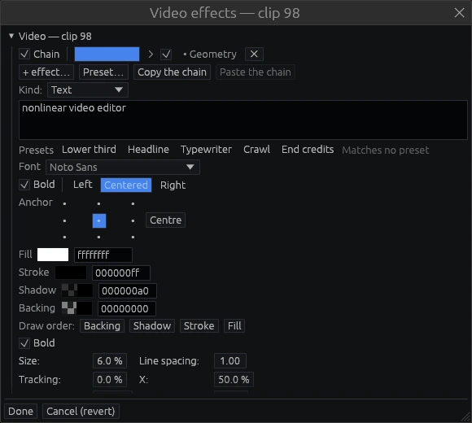

# Reels and generators

## Reels (nested compositions)

Select events and choose **Edit → Collapse selection into a reel**. The events become
one reel event that you can place, trim, slow down and reuse like any clip. Every
instance plays the same reel, so editing the reel updates all of them; a ×N badge shows
how many places use it.

- **Enter** or a double-click expands the reel *in place*. Its tracks open under the
  instance, and the rest of the project keeps playing around it.
- **Enter** again opens the reel on its own, with its own zero.
- **Esc** steps back out, one level at a time.
- The bin shows reels next to files, with a mini-map of their content.
- Inside a reel, right-click a parameter's label to **publish** it. Each instance then
  sets its own value — for example, the text of a lower-third reel.
- **Edit → Remove unused reels** cleans up.

## Generators

**Edit → Create a generator…** adds media that has no file, at the playhead. Right-click a
track and pick **Create a generator…** there to put it exactly where you clicked: a video
track lists the picture kinds, an audio track the sound kinds. A generator is placed and
edited like a clip. Its settings live on the event, and they open as the first slot of
the event's effects window.

- **Background:** Solid color, Gradient, Four-corner gradient, Noise field,
  Transparent.
- **Shapes:** Rectangle, Ellipse, Line.
- **Titles and countdown:** Text, Timecode, Countdown leader.
- **Signal check:** Checkerboard, SMPTE bars, Colour bars 75%, Colour bars 100%, Grey
  ramp, Grey steps, Chroma plane, Level window.
- **Audio:** Tone, Audio noise (white, pink, brown), Sine sweep, Beep train, Silence. They
  have no picture and land on an audio track.

**Sound generators.** A level is in dBFS: a tone's level is its peak, a noise's level is
its RMS, so −20 dBFS of either reads the same on a meter. A sweep runs from its start to
its end frequency over its duration, logarithmic or linear, and repeats. A beep train
sounds the tone for its length once every period — the countdown's sync pip. A tone, a
sweep or a beep can go to the left or right channel only. The sound does not change when
you seek: playback, a render and a repeat give the same samples.

**Titles.** You set the text, font, size, tracking, line spacing, alignment and anchor,
plus fill, stroke, shadow and backing, and the order they are drawn in. The presets
(Lower third, Headline, Typewriter, Crawl, End credits) set values and curves. You can
edit those curves like any others.

Fonts are vendored, so a title renders the same on every machine.
