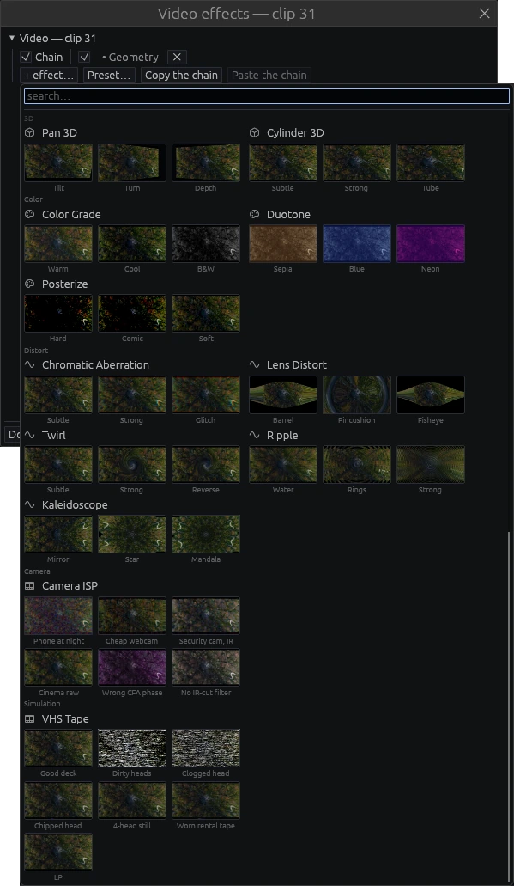
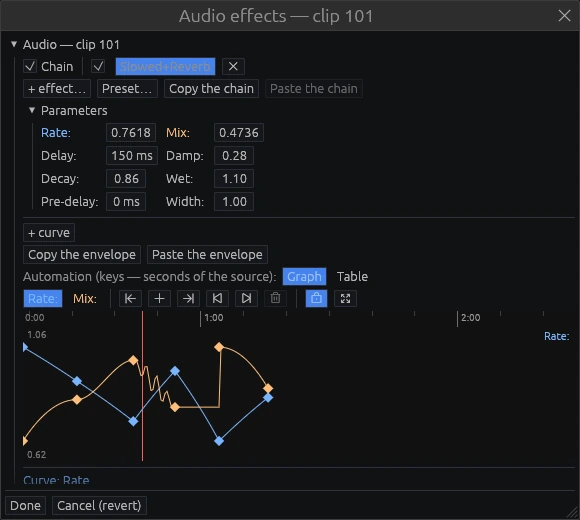

# Effects and automation

Double-click an event (or choose **Effects…** in its menu) to open its effects window.
A linked pair opens as one window with a section for the picture and one for the sound.

## The chain

The top row of each section is the chain: a master switch, then one slot per effect with
its own switch and a cross to remove it. Drag slots to reorder them. **+ effect…** opens
the picker, **Preset…** saves or applies a whole chain, **Copy the chain** and **Paste the
chain** move chains between events (curves included). The first slot of a video event is
**Geometry** — position, zoom, rotation, crop and anchor — and it cannot be removed.

The picker is a gallery: each video effect and each preset variant is previewed on the
event's own frame. Type to filter.

**Video:** Geometry, Mirror, Corner Pin, Blur, Sharpen, Radial Blur, Greenscreen, Drop
Shadow, Edges, Noise, VHS, EventGrid, Vignette, Pixelate, Halftone, Glow, Pan 3D,
Cylinder 3D, Color Grade, Duotone, Posterize, Chromatic Aberration, Lens Distort, Twirl,
Ripple, Kaleidoscope, the [simulations](#simulations) VHS Tape, Camera ISP and Datamosh —
and Slowed+Reverb, which slows the picture too.

**Audio:** Gain, Slowed+Reverb, Pitch Shift, Filter, EQ, Distortion, Bitcrusher, Tremolo,
AutoPan, Vibrato, Chorus, Flanger, Phaser, Delay, Compressor, Gate, Limiter, Stereo
Width. Effects that look ahead (the limiter, pitch shift) are latency-compensated, so
the sound stays in sync with the picture.

## Slowed+Reverb

- **Rate** slows the material (0.86 is a classic "slowed" feel).
- **Mix** sets how much reverb is heard.
- **Delay, Damp, Decay, Wet, Pre-delay and Width** shape the reverb itself.

On a linked pair the picture slows down with the sound. The video side has its own
switch in the chain, so you can slow only the sound.

The rate is a real time map. The event's filmstrip and waveform show the material it
actually plays, and the timeline cursor stays in sync with them.

## Automation curves

Any numeric parameter can change over time:

1. Press **+ curve** under the parameters and pick the parameter. It appears as a
   coloured button above the graph.
2. Click on the graph to add keys and drag them with the mouse. The parameter field
   always shows the value at the playhead; editing the field edits the key under the
   playhead.
3. Each key sets the shape of the segment after it:
   - linear, smooth, ease in, ease out;
   - hold (a step);
   - zigzag (triangle, square or sine, with periods and amplitude);
   - a formula.

   A curve can also be *linked* to another property, with an expression.
4. Switch **Graph** / **Table** to edit the same keys as numbers.
5. **Copy the envelope** / **Paste the envelope** move curves between parameters, events
   and even different effects. Matching fields are pasted silently; for the rest you
   choose.

Keys are stored in the time of the source material. Trimming or moving an event never
shifts its automation relative to the picture.

The same curves drive transitions, generators (an animated title is just curves on the
title), the Geometry node and published reel parameters.

## Masks

A mask decides where a picture, an effect or a track shows.

- **On the event's picture:** select one video event under the playhead, right-click the
  preview → **Mask** → **Rectangle**, **Ellipse** or **Pen**, and draw on the picture. The
  mask follows the event when you move, scale or rotate it. Its list is the **Masks** group
  of the Geometry slot.
- **On one effect:** the **Masks** group under that effect's parameters in the effects
  window. The effect then works only inside the mask — a blur on a face, a colour in a
  corner.
- **On a track:** the **Masks** group of the track window. A track's masks do not animate.

Drawing: drag for a rectangle or an ellipse (<kbd>Shift</kbd> — a square or a circle,
<kbd>Alt</kbd> — from the centre). With the pen, click for a corner point, click and drag
for a smooth one; click the first point or press <kbd>Enter</kbd> to close the path,
<kbd>Backspace</kbd> removes the last point, <kbd>Esc</kbd> cancels. Afterwards drag the
points, the handles, the body, the feather handle; <kbd>Alt</kbd>+click a point switches it
between corner and smooth, double-click the outline adds a point, <kbd>Delete</kbd>
removes the selected one. **Edit on the picture** brings a mask's points back to the
preview.

Each mask has **Mode** (Add, Subtract, Intersect, Difference — how it combines with the
masks above it; they combine from the top down), **Invert**, **Opacity**, **Feather** with
a **Falloff** (Smooth or Linear) and **Expansion**. Opacity, feather and expansion take
curves like any parameter. The stopwatch **Animate the shape** keys the whole shape at the
playhead; after that, dragging a point at another moment keys the shape there.

A project with masks is saved as `.kt` format 2; older versions of the program cannot
open it.

## Simulations

These effects (the **Simulation** category of the picker) model the device and its
process; the look follows from the causes. Their noise and defects are the same on every
play, seek and render.

**VHS Tape** writes the picture to a tape the way a VHS deck does — brightness on an FM
carrier, colour on a low colour-under carrier, slanted tracks from heads on a spinning
drum — and plays it back. Its panel is a deck: PAL or NTSC, SP, LP or EP, 2 or 4 heads,
Play or Still, TBC, Dropout compensator, Comb filter, tracking. Click a head on the drawn
drum to set it Clean, Dirty, Clogged or Chipped. **Two decks** records on one and plays on
another. Presets: Good deck, Dirty heads, Clogged head, Chipped head, 4-head still, Worn
rental tape, LP. The older **VHS** effect is a quick look without the process.

**The sound of the tape.** Put VHS Tape on an event with linked audio and the audio gets
**VHS Tape** too — the same deck, one panel: its **Sound** section chooses **Hi-Fi**,
**Normal (linear)** or **Mix**, mono or stereo linear tracks, **Dolby B**, the audio head's
gap and dirt, the bias and the record level. Hi-Fi is FM written by the drum's heads: a
clogged or dirty head, mistracking or a dropout breaks the sound in the same field the
picture loses. The linear track is read by a still head at the tape's speed: LP is duller,
the narrow stereo tracks hiss more, and the capstan's flutter wobbles the pitch. Its checkbox
in the audio's chain lets the deck's sound out or keeps the event's own.

**Camera ISP** treats the frame as a developed picture: it undoes the source camera into a
scene, films it through a simulated lens (defocus, distortion, chromatic aberration,
vignetting, colour shading) onto a colour mosaic (RGGB and its phases, Quad Bayer,
X-Trans, RGBW, RGB-IR) and a sensor that counts electrons with real noise, then develops
it with the camera's processor: black level, row/column correction, defect pixels, green
equalisation, raw denoise, lens shading, white balance, demosaic, distortion and CA
correction, colour matrix, tone curve, denoise, sharpening, YUV. Every block can be
switched off or set wrong; **View** shows the picture after any stage. Presets: Phone at
night, Cheap webcam, Security cam, IR, Cinema raw, Wrong CFA phase, No IR-cut filter.

**The sound of the camera.** Put Camera ISP on an event with linked audio and the audio gets
**Camera ISP** too: the event's sound is filmed again through the device's **Microphone** —
the last block of the panel. The scene's level and the wind reach an acoustic port (a real
resonator: its diameter, length and cavity set its peak), the capsule adds its noise and
overloads, the **Automatic gain control** lifts quiet moments so the room breathes between
words, **Noise suppression** takes the floor down and leaves its artefacts when pushed, and
the device's codec finishes it: AAC, 16 kHz PCM or 8 kHz G.711. The looks set all of it:
Phone at night, Cheap webcam and Security cam each sound like the device they film with.
Cinema raw and the two defect presets keep a plain camera microphone.

**Datamosh** encodes the clip with its own small video codec — motion search, a
prediction loop, quantised detail, keyframes — and breaks it on purpose. The encoding runs on the
graphics card, or through Vulkan on the processor when there is no card. With neither, the
frame stays intact and the panel says why. **Mosh** drops the
keyframes, so the previous shot is dragged by the new shot's motion; **Bloom** repeats one
frame's motion; **Freeze reference** holds the picture being moved; the vectors can be
scaled, turned, swapped or taken from the track above or below (**Vectors from**); detail
or whole blocks can be lost. These take curves: switch the mosh on and off on the beat, or
put a **Reset** key where the picture should start clean. Presets: Cut mosh, Bloom,
Transplant, Melt. A frame looks the same whether you play up to it, jump to it or render
it.

**The sound of the stream.** Put Datamosh on an event with linked audio and the audio gets
**Datamosh** too: the sound is coded by a small audio codec into the same stream and broken
at the same moments. A dropped keyframe takes its audio packet with it — the decoder patches
the gap and the sound smears until the next intact keyframe, so a **Reset** key heals both;
**Bloom** repeats a packet, **Freeze reference** holds the codec's prediction, **Residual**
and **Loss** act on the sound as on the picture. The panel adds the **audio bitrate** and
**spectral prediction**.

## Track effects and ducking

Every track has its own chain in the track window (right-click the header). The
compressor has a sidechain key: put it on the music track, key it from the dialog track,
and the music ducks under speech — that is the **Audio ducking** section of the track
window.

Next: [The morpher](morpher.md).
