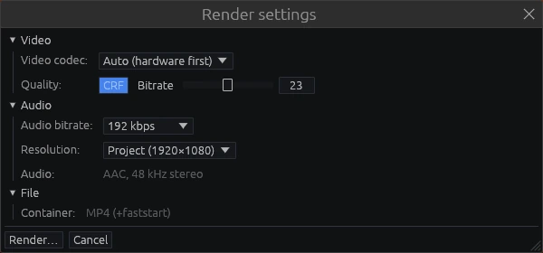

# Export and kt-cli

## Render



**File → Render…** (or the render button) exports the region, or the whole project — the window
shows which, and with a region set you can choose the whole project instead.

| Setting | Values |
|---|---|
| Preset | the factory presets (named by codec, size and rate) and your own; *Save as preset*, *Delete preset*. The last settings come back at the next render |
| Codec | H.264, H.265, AV1, VP9, ProRes 422 HQ — each tries the hardware encoders first |
| Encoder | *Auto (hardware first)* or any encoder of that codec your FFmpeg can open |
| Rate | Quality (CRF/CQ 0–51, lower is better), VBR (average and maximum, Mbit/s) or CBR |
| Encoder speed | fastest, fast, balanced, slow, slowest — mapped onto the encoder's own presets |
| Keyframes, B-frames | a keyframe at least every N seconds (a scene cut may bring one earlier); 0–4 B-frames |
| Bit depth, colour | 8- or 10-bit (the profile follows); BT.601 or BT.709, limited or full range — written into the file and used for the conversion |
| Size and rate | the project's, 720p, 1080p, 1440p, 2160p, the largest source or a custom size; the project's frame rate or 24, 25, 30, 48, 50, 60 |
| Audio | AAC or Opus (with a bitrate), PCM 16/24-bit, FLAC, or none — 48 kHz stereo |
| File | MP4, MOV, MKV or WebM; the range; a title and a comment; the estimated size |

A choice your FFmpeg or the container cannot take is shown greyed with the reason. Two-pass encoding is
not offered: it needs a temporary file and a second full render, and the quality mode reaches the same
goal in one pass.

The file is named after the project, region marker and length, with the container's extension,
e.g. `kt-song-chorus-4s.mp4`. Before starting, the dialog warns about missing sources and
about muted or solo tracks.

Rendering runs inside the editor through the system's libavcodec and libavformat. There
are no temporary files and no external `ffmpeg`. It uses the same composition code as
the preview, so the file contains what you saw. It can be paused.

While it runs, the render window names the encoder it opened, shows the frames, elapsed
and remaining time, the size and bitrate so far and a speed graph, and keeps a log. At the
end it gives the loudness of the result (LUFS, true peak) and buttons to open the file, its
folder or the log. If the file already exists, it asks before replacing it.

## kt-cli

`kt-cli` is the same engine without a window:

```bash
cd src
cargo run -p kt-cli -- <command> …
```

| Command | What it does |
|---|---|
| `version` | print the version |
| `ffmpeg [--probe-encoders]` | which FFmpeg was loaded and which folders were rejected and why; `--probe-encoders` opens every hardware encoder to see which work |
| `new <out.kt>` | an empty project |
| `demo <out.kt> [--files \| --generators]` | a demo project on synthetic sources (renders with no media at all); `--generators` draws every picture with generators, as the tour does |
| `showcase <out.kt> --sources <dir>` | a dense montage cut from every video in a directory — the README project |
| `import <in.otio\|in.ktproj> <out.kt>` | import OpenTimelineIO or an old Kinetren project |
| `export-otio <in.kt> <out.otio>` | export OpenTimelineIO |
| `roundtrip <in.otio> [out.otio]` | read and write OTIO back (a check of the exchange door) |
| `render <in.kt> <out.wav> [--allow-missing]` | render the audio |
| `export <in.kt> <out.mp4\|.mov\|.mkv\|.webm> [encoder] [--set key=value]…` | render video and audio with the render window's settings: `--container`, `--video`, `--rate`, `--quality`, `--bitrate`, `--audio`, `--size`, `--fps`, and `--set` for any key (`keyint`, `bframes`, `speed`, `depth`, `matrix`, `range`, `maxrate`, `abitrate`, `title`, `comment`, `encoder`); the extension picks the container |
| `probe <in.kt> <from_s> <to_s> [--time]` | what plays in that range: effective events after morph layers, prefetch order, decode order; `--time` measures whether audio rendering keeps up with real time |

`--force` lets any command overwrite an existing file. Without it, nothing is
overwritten.

Judge speed only on a release build (`cargo build --release -p kt-cli`); the debug build
is several times slower.

## OpenTimelineIO

**File → Export ▸ OpenTimelineIO…** writes a self-contained `.otio`:

- standard schemas for everything OTIO can express;
- Kinetren's own data under `metadata["kt"]`;
- data from other programs kept untouched.

**File → Import older Kinetren project…** reads an `.otio` back into a new `.kt`.
