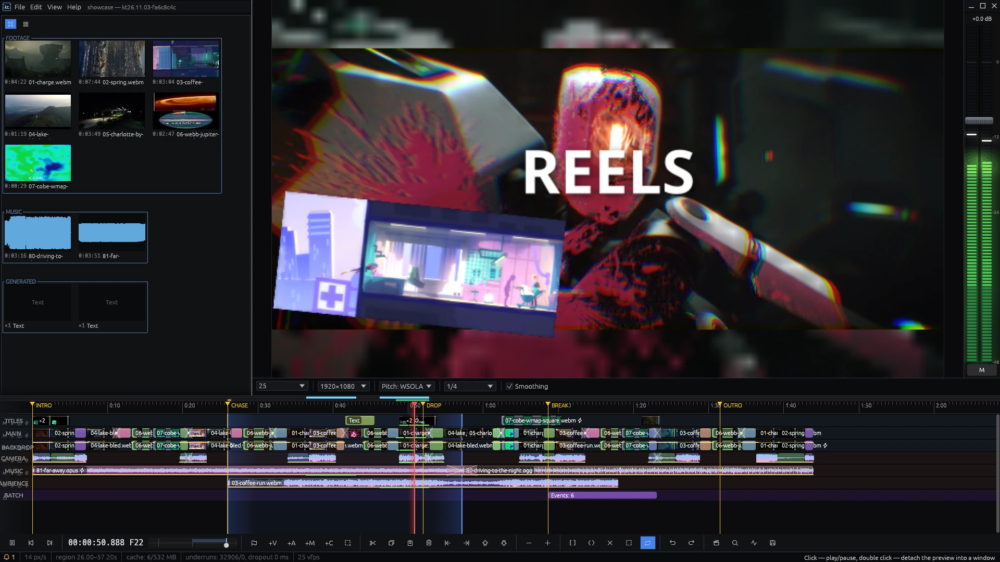

# Getting started

This page takes you from an empty window to an exported MP4. For installation see the
[Install](../../README.md#install) in the README.

## The window

- **Media bin** (left): every file, generator and reel of the project, with thumbnails
  and durations. Cards can be grouped and locked.
- **Preview** (centre) with the level meters and master fader on the right. Under it:
  the project frame rate, the preview resolution, the pitch engine and the preview
  quality.
- **Timeline** (bottom): the ruler with markers and the region, then the tracks — video
  first, then audio, then morph tracks. Track headers carry mute (M), solo (S) and lock.
- **Toolbar** (under the timeline): transport, timecode, speed, and the editing buttons
  — markers, adding tracks, split, copy/paste, delete, trims, zoom, region, loop, undo,
  render, search, diagnostics and save. In a narrow window the buttons that do not fit
  move into the **⋯** menu at the end of the row.
- **Status line** (bottom): zoom, region, cache, underruns, shown video fps, and on the
  right the hint for whatever is under the mouse.

## A first edit

1. **Add media.** Drop video or audio files on the window: a file dropped on the
   timeline lands where you drop it, a file dropped on the bin becomes a card you can
   drag in later. A video with sound arrives as a linked pair — a video event and an
   audio event that move together.
2. **Play.** Tap **Space** to play and pause; hold Space to speed up towards 4×. Click
   the ruler to move the playhead; **A**/**D** (or **Home**/**End**) jump to the
   previous/next marker, region or event edge.
3. **Cut.** Put the playhead where the cut goes and press **S**. Drag events to move
   them; drag their edges to trim. Dragging an event onto its neighbour makes a
   crossfade.
4. **Add effects.** Double-click an event to open its effects window and press
   **+ effect…** — see [Effects and automation](effects-and-automation.md).
5. **Mark a region.** Drag on the ruler, or press **I** and **O** at the start and end.
   **L** loops it.
6. **Save.** **Ctrl+S** writes a `.kt` project file. Autosave keeps a recovery copy in
   the background. If the program crashes, a window says so at once, with the error and
   the last lines of the log: **Restore the project** starts it again and offers the
   unsaved work; **File → Recover unsaved work…** does the same later.
7. **Render.** **File → Render to MP4…** — see [Export and kt-cli](export.md).

## Projects

**File → New** and **File → Open…** work with `.kt` projects. Files from other
programs (`.otio`) and from older Kinetren versions (`.ktproj`) come in through
**File → Import older Kinetren project…**, which creates a new project and leaves the
original untouched. **File → Project settings…** sets frame rate, size and the rule for
fitting sources of another size (fit with transparent borders, fill, stretch, or as is).

## Help and the tour

At start the welcome window shows three columns: **Start** (the tour, the templates drawn in
their frame's shape, the five lessons with your progress), **Recent** (your projects with a
picture of each) and **What's new**. Each column scrolls on its own, and the window can be made
as large as you like. **Enter** takes the highlighted tile. Whether the window opens at start
is set in **File → Preferences…**; **Help → Welcome window…** opens it at any time. **Help → Guide…** searches this guide from inside the program —
type what you want to do, or open a page. **Help → Start the tour** opens short lessons on a
demo project. What changed in each version: [What's new](whats-new.md).

## Preferences and language

**File → Preferences…** holds the program's own settings, the same for every project: whether
the welcome window opens at start, the **Language** (English, Spanish, Simplified Chinese,
Russian and Arabic; *Auto* follows the system), **Economy UI** for weak graphics cards, the
anonymous usage statistics, the daily check for a new version, and where FFmpeg was found.
Each switch lives there and nowhere else. The **View** menu keeps what changes the view: the
detached preview, Diagnostics and the notices.

## Diagnostics

When playback stutters, **View → Diagnostics…** (or the gauge button on the toolbar) shows
the Performance numbers — cache, underruns, shown video frames, decoding, the backend
(GPU or CPU) — and three graphs on one time axis: **Quality (FPS / hit%)**, **FFmpeg
activity (/s)** and **Cache churn (/s)**. **Save the playback journal** writes the recent
playback events and counters to a file, for a bug report. The **Problem log** under them notes stalls,
underruns and cache trouble as they happen. Enlarge the window and the graphs grow.

Next: [The timeline](timeline.md).
