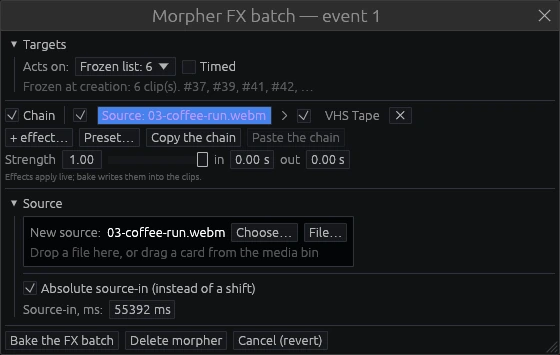

# The morpher

A morpher is an event on a morph track that changes the events under it for as long as
it lasts — an adjustment layer for both picture and sound.

- **Targets.** A morpher acts on everything below its row by default. It can also act on
  a frozen list of events, on named range markers, or on named areas.
- **FX batch.** Its chain starts with a purple *source* slot, followed by the effects it
  adds to every target. Video and audio effects share one strip; each goes to the targets
  of its own kind.
- **Source.** It can swap the targets' source for another file, or shift their source-in.
- **Strength and fades.** Strength mixes the batch in. The in and out fades ramp it at
  the morpher's edges.
- **Timed.** On, the morpher acts only inside its block; off, it patches its targets
  whole, wherever the block sits.
- **Bake the FX batch** (named **Bake the morph** when the batch has no effects) writes
  the result into the events and removes the morpher.

Right-click a morph track and choose **Add morpher here**. If there is no morph track
yet, use **Add a Morph track** in a track header's menu. Double-click the morpher to open
this editor.

The `probe` command of [kt-cli](export.md#kt-cli) lists the effective events after morph
layers. It is the quickest way to find out why something plays the way it does.
